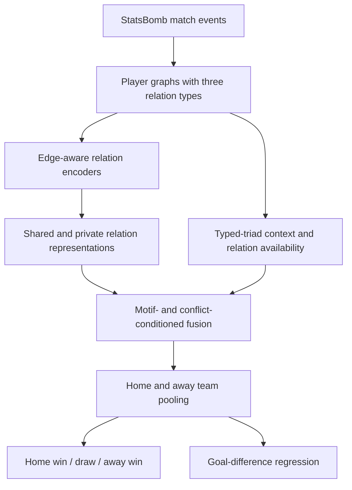

# MotifHetGNN

**Football network motifs and heterogeneous graph learning with SPARC-GNN.**

MotifHetGNN studies how passing, opposition and turnover structure relates to
football match outcomes. It combines a motif-analysis pipeline with
**SPARC-GNN**, a heterogeneous graph neural network that separates shared and
relation-specific information and learns how to combine observed relations.
The reference study uses **3,464 matches from 21 competitions** in StatsBomb
Open Data.

[Quick start](#quick-start) · [Reference results](#reference-results) ·
[Reproducibility guide](REPRODUCIBILITY.md) ·
[Experiment runbook](RUNBOOK.md) ·
[Citation](#citation-and-license)

## What this repository provides

- **Football graph construction:** player nodes, directed passing networks and
  heterogeneous graphs with passing, adversarial and turnover relations.
- **Structural analysis:** exact motif enumeration, reciprocity, spatial and
  temporal summaries, and finite-size connected-subgraph controls.
- **Relation learning:** edge-aware encoders, shared/private decomposition,
  relation-availability masks and motif/conflict-conditioned fusion.
- **Evaluation protocols:** complete-match analysis, chronological and
  generalization splits, and prediction from event prefixes at 15, 30, 45, 60
  and 75 minutes.
- **Reproducibility resources:** fixed cohort and split manifests, per-seed
  reference metrics, synthetic tests and feature/provenance audits.

## Method overview



The SPARC-GNN implementation is in [src/gnn/mcar_model.py](src/gnn/mcar_model.py);
the main experiment selects its configuration in
[scripts/run_information_sciences_models.py](scripts/run_information_sciences_models.py).
Opposition and turnover events use a deterministic opposing-team anchor because
the parsed events do not identify a player-to-player destination. Interpret
these edges as team-level interaction proxies.

Two evaluation settings are kept separate:

| Setting | Available information | Interpretation |
| --- | --- | --- |
| Complete match | Graphs built from the entire match | Structural retrodiction: relating observed match structure to its outcome |
| Temporal cutoff | Events strictly before the cutoff; cutoff-available context for score-aware variants | Prospective prediction of the final outcome |

Primary model inputs exclude goal-assist and shot-assist annotations. Final
scores serve as targets; current-score inputs belong to the temporal setting.

## Quick start

Use **Python 3.11 or later**. The recorded study environment uses Python 3.11;
package versions are listed in
[reproducibility/runtime_versions.json](reproducibility/runtime_versions.json).

### 1. Get the code and create an environment

```bash
git clone https://github.com/wind-whispered/MotifHetGNN.git
cd MotifHetGNN
python -m venv .venv
```

Activate the environment on Linux or macOS:

```bash
source .venv/bin/activate
```

Or in Windows PowerShell:

```powershell
.\.venv\Scripts\Activate.ps1
```

### 2. Install dependencies

Install a PyTorch build for your operating system and compute platform using the
[official PyTorch installation selector](https://pytorch.org/get-started/locally/),
then install the project and its experiment, testing and plotting dependencies:

```bash
python -m pip install -e ".[gnn,dev,pitch]"
```

The pure-Python motif enumerator is included. The optional external
`gtrieScanner` backend is described in the
[reproducibility guide](REPRODUCIBILITY.md#motif-enumeration-backend).

### 3. Check the installation

Run these commands from the repository root:

```bash
python -m pytest tests -q
python -m scripts.check_finite_growth_theory --max-n 5
```

These checks use synthetic inputs and exact small graphs, so they do not require
StatsBomb data. Omit `--max-n 5` for the default exhaustive check through six
vertices. Full empirical reproduction requires the data-preparation and
experiment stages below.

### 4. Run the study

Follow the [reproducibility guide](REPRODUCIBILITY.md) to obtain the data, rebuild
graphs and verify split membership. Then use the
[experiment runbook](INFORMATION_SCIENCES_RUNBOOK.md) for the ordered training,
analysis and audit commands. Raw events, processed graphs and trained
checkpoints are generated locally and are not included in this repository.

## Reference results

The table below summarizes the packaged **complete-match chronological test
results** over five seeds (`42, 7, 13, 21, 37`) on 692 test matches. Values are
mean ± sample standard deviation. Accuracy and macro-F1 use the 0–1 scale;
MAE measures goal-difference error. Higher accuracy and F1 are better; lower
MAE is better.

| Model | Accuracy ↑ | Macro-F1 ↑ | MAE ↓ |
| --- | ---: | ---: | ---: |
| TeamPool-MLP | 0.509 ± 0.010 | 0.397 ± 0.031 | 1.499 ± 0.026 |
| HeteroSAGE-sum | 0.561 ± 0.011 | 0.511 ± 0.014 | 1.372 ± 0.013 |
| R-GCN | 0.542 ± 0.019 | 0.504 ± 0.011 | 1.437 ± 0.019 |
| HGT | 0.508 ± 0.024 | 0.407 ± 0.015 | 1.499 ± 0.009 |
| EdgeAware-Fixed | 0.514 ± 0.012 | 0.434 ± 0.043 | 1.489 ± 0.026 |
| MotifGate-ObservedOnly | 0.519 ± 0.007 | 0.413 ± 0.036 | 1.526 ± 0.057 |
| SPARC-GNN | 0.510 ± 0.016 | 0.445 ± 0.038 | 1.515 ± 0.018 |

Sources: [per-seed metrics](results/reference/table3_clean_per_seed.csv) and
[full summary](results/reference/table3_clean_summary.csv). These are the fixed
Table 3 reference results, not outputs from a new run. HeteroSAGE-sum has the
strongest mean performance on the three metrics shown in this setting.
Validation-search records in `results/development/` describe separate
experiments and should be reported separately.

## Repository layout

| Path | Contents |
| --- | --- |
| [src/data/](src/data/) | StatsBomb loading, parsing and cleaning |
| [src/networks/](src/networks/) | Graph construction, features and event clocks |
| [src/motifs/](src/motifs/) | Enumeration, randomization, reciprocity and motif statistics |
| [src/gnn/](src/gnn/) | Datasets, models, training and evaluation |
| [src/analysis/](src/analysis/) | Structural and statistical analyses |
| [src/visualization/](src/visualization/) | Plotting and table utilities |
| [scripts/](scripts/) | Experiment entry points, figure generation and audits |
| [tests/](tests/) | Synthetic regression tests |
| [reproducibility/](reproducibility/) | Cohort, split, environment and provenance records |
| [results/reference/](results/reference/) | Packaged primary metrics and structural summaries |
| [results/development/](results/development/) | Validation-only development records |
| [config.yaml](config.yaml) | Data paths and shared configuration |

Experiment scripts also define protocol constants and supported environment
overrides; see the [runbook](INFORMATION_SCIENCES_RUNBOOK.md#configuration-and-resuming).

